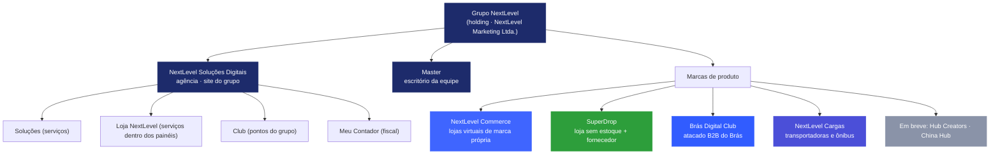
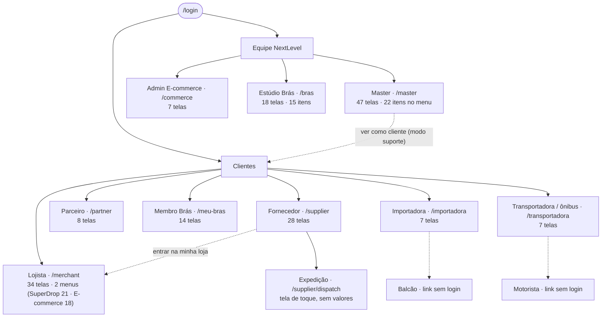
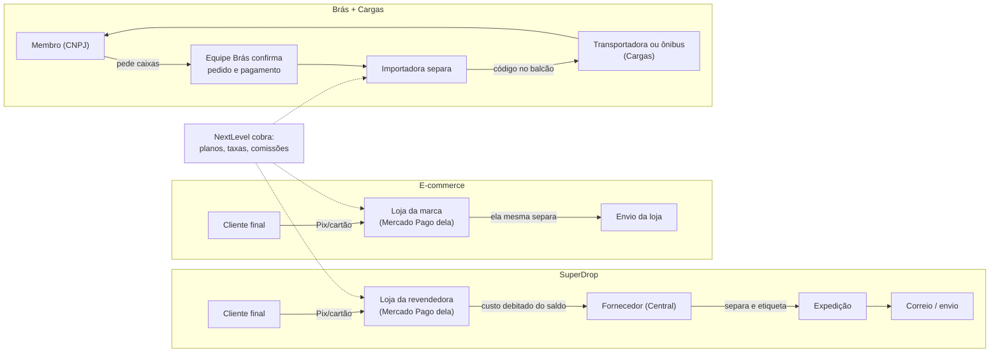
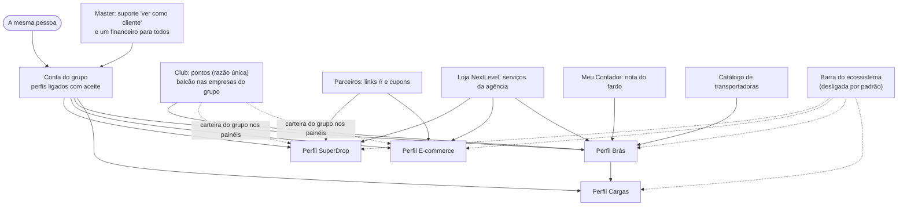

Grupo NextLevel · levantado do código em 18/10/2026

# Mapa do ecossistema NextLevel

Todas as marcas, cada site, cada painel e como eles se ligam, seguidos de uma análise do racional com o que dá para simplificar e acelerar. Tudo vem do código publicado (versão de 18/10), não de memória.

## Em 1 minuto

- **1** motor: mesmo código, mesmo banco, mesmo Render
- **7** códigos de marca (4 no ar, 2 "em breve", 1 holding)
- **8** tipos de login (papéis) e 3 consoles da equipe
- **218** telas no sistema
- **7** endereços na internet
O desenho central está certo: **uma plataforma só, várias marcas por cima**. A marca vem do endereço, cada empresa só enxerga os próprios dados, e o Master enxerga tudo. As fragilidades estão em três lugares:

- o esforço está indo para frentes fora do foco que você mesmo definiu;
- a E-commerce ainda nasce como "um SuperDrop sem fornecedor", e é daí que vêm os vazamentos;
- há muita coisa construída e desligada, além de nomes que confundem (dois "Clubs").

## 1. Mapa das marcas

Quem é dono do quê. A holding (NextLevel) não vende nada direto: abriga a agência (Soluções), o Master e as marcas de produto.

| Marca | Endereço | Para quem | Quem paga o quê | Estado |
|---|---|---|---|---|
| NextLevel Commerce | lojas.nextlevelgroup.com.br | Marca própria que vende no Instagram e quer loja (Juliana, Rodrigo) | Plano Start/Pro/Scale + taxa de plataforma; o cliente final paga direto na conta Mercado Pago da loja | no ar home imersiva nova |
| SuperDrop | superdrop.com.br | Revendedora sem estoque (Carla) e fornecedor com estoque (Marcos) | Lojista: plano + taxa por pedido + recarga de saldo; fornecedor: setup + mensalidade | em produção, com clientes |
| Brás Digital Club | brasdigitalclub.com.br | Lojista do interior (Dona Cida), vendedor de marketplace, importadoras do Brás | Comprar é grátis; análise paga (Prata/Ouro/Platinum); importadora paga comissão | no ar fora do foco declarado |
| NextLevel Cargas | cargas.nextlevelgroup.com.br | Transportadora pequena, autônomo, dono de ônibus de excursão | Grátis com limite; Pro/Premium; comissão por carga ou fardo | no ar 1ª rodada de cadastro |
| Grupo / Soluções | nextlevelgroup.com.br | Empresas que compram serviço da agência | Serviços avulsos (checkout da NextLevel) | no ar |
| Hub Creators · China Hub | hubcreators… · chinahubglobal.com.br | Criadores · importadores | Ainda nada | página "em breve" |

## 2. Mapa de cada site

O que abre em cada endereço. Página que não pertence ao endereço manda a pessoa para o endereço certo (redirecionamento), nunca para um erro.

```mermaid
flowchart LR
  subgraph G["nextlevelgroup.com.br · site do grupo"]
    G0["/ → leva a /solucoes"] --- G1["/solucoes + produtos"] --- G2["/loja-nextlevel"] --- G3["/club"] --- G4["/meu-contador"] --- G5["/termos · /privacidade"]
  end
  subgraph MS["master.nextlevelgroup.com.br · escritório"]
    M1["/login"] --- M2["Master · Admin E-commerce · Estúdio Brás"] --- M3["todo o resto → /login"]
  end
  subgraph SDs["superdrop.com.br"]
    S1["/ (home v4)"] --- S2["/como-funciona · /planos · /faq"] --- S3["/cadastro · /quero-minha-loja · /ativar"] --- S4["/seja-fornecedor · /parceiros · /temas"] --- S5["/f/fornecedor · /store/loja · /loja/loja"] --- S6["/r/parceiro · /c/cupom"]
  end
  subgraph ECs["lojas.nextlevelgroup.com.br"]
    E1["/ (home imersiva)"] --- E2["/planos · /temas · /faq"] --- E3["/cadastro · /quero-minha-loja · /ativar"] --- E4["/store/loja · /loja/loja"]
  end
  subgraph BDs["brasdigitalclub.com.br · fechado"]
    B1["/ (home + vídeos)"] --- B2["/cadastro · /fornecer · /ativar"] --- B3["/d/descoberta (link do Shorts)"] --- B4["/balcao/código (link sem login)"]
  end
  subgraph CGs["cargas.nextlevelgroup.com.br · lista fechada"]
    C1["/ (home + cadastro)"] --- C2["/ativar · /termos · /privacidade"] --- C3["/motorista/código (link sem login)"]
  end
```

#### Regras que valem para todos

- **Painéis da equipe** (/master, /commerce, /bras) só no endereço do Master; nos outros endereços, levam até ele.
- **Painéis de cliente** abrem no endereço da marca deles: membro e importadora na Brás, transportadora na Cargas.
- **Páginas da agência** (Soluções, Loja NextLevel, Club, Meu Contador) só no site do grupo.
- **Vitrine de loja** aberta no endereço da marca errada vai para o endereço da marca dona.
- **Termos e privacidade:** um texto do grupo em todos os endereços. A Brás tem o dela.

#### Endereços técnicos e links privados

- `/r/…` e `/c/…`: links de parceiro e de convite. Guardam quem indicou por 30 dias.
- `/balcao/…`, `/balcao-club/…` e `/motorista/…`: telas sem login, abertas por um link secreto, para quem trabalha no balcão ou na estrada.
- `/?previa=imersiva`: prévia da página nova de Brás, Cargas e SuperDrop enquanto as fotos não chegam.
- `/gravacao`: estúdio de gravação de aulas, só na demonstração.

## 3. Mapa de cada painel

Cada pessoa entra pelo mesmo `/login` e cai no painel do papel dela. O menu muda conforme o papel, a marca da loja e o plano.

| Painel | Marca | Primeira tela | O que tem no menu |
|---|---|---|---|
| **Master** | todas | Visão do ecossistema + "O que exige atenção" | Operação (clientes e suporte, pedidos, resumo, erros, integridade, qualidade, CRM) · Rede (fornecedores, redes, lojas, catálogo) · Negócio (parceiros, escritório, torre, equipe, 2 financeiros) · Plataforma (templates, planos, configurações) |
| **Admin E-commerce** | E-commerce | Visão geral | Lojas, vendas, catálogo das lojas, interessados, assinaturas, plataforma |
| **Estúdio Brás** | Brás | O que pede ação agora | Pedidos, comissões, atendimento, descobertas, importadoras, pauta, transportadoras, ônibus, empresas do grupo, indicações, Meu Contador, membros, acesso, regras |
| **Lojista** | SuperDrop · E-commerce | Pulso da loja + fila do dia | Vendas, catálogo, marketing, loja virtual, gestão. No SuperDrop entram saldo, recargas e etiquetas. |
| **Fornecedor + Expedição** | SuperDrop | Esteira ao vivo | Pedidos, recargas, lojistas, minha loja, produtos, estoque, equipe, corte, faturas, financeiro |
| **Parceiro** | SuperDrop · E-commerce | Funil do mês + link | Links, cupons, CRM, catálogo comercial, indicados, financeiro |
| **Membro** | Brás | Fila do dia + painel por nível | Fornecedores, descobertas, pedidos, fretes, indique e ganhe, Meu Contador, suporte |
| **Importadora** | Brás | Hoje (o que separar) | Pedidos, transportadoras, produtos e caixas, estoque, galpões e equipe |
| **Transportadora / ônibus** | Cargas | Fila do dia + chamadas | Cargas, rotas e viagens, importadoras na rede, extrato, perfil e motorista |

## 4. Conexões

### Como o dinheiro e o pedido andam em cada marca

### O que liga uma marca à outra

## 5. Análise do racional

### O que está certo e deve ficar

#### mantém Um motor só

Uma correção vale para todas as marcas, há uma conta de banco e um deploy. É o que permite um time pequeno operar seis frentes.

#### mantém A marca vem do endereço

Nenhum texto de marca fica fixo nas telas novas. O site sabe quem é pelo endereço, e a loja pela organização dona dela.

#### mantém Cada empresa vê só o que é dela

Tenant isolado, permissões conferidas no servidor e modo suporte registrado. É a base da confiança de fornecedor e importadora.

#### mantém Links sem login no chão de fábrica

Balcão, motorista e balcão do Club funcionam por link secreto. Isso remove a maior barreira de adoção de quem não usa sistema.

### Onde o esforço foi parar

Decisões registradas da D91 à D170 (80), por frente. O foco que você definiu no `CLAUDE.md` é SuperDrop, E-commerce e Master; Brás ficaria "para outra etapa".

- Brás · Club · Cargas: **37**
- Grupo · Master · Preço: **17**
- E-commerce: **11**
- Outros: **10**
- SuperDrop: **5**
Contagem pelos títulos das decisões; uma decisão pode tocar mais de uma frente.

### As 8 tensões principais

#### 1. O foco declarado e o foco real não batem

Quase metade das decisões foi para Brás, Club e Cargas, e só 5 para o SuperDrop, que é a única marca com clientes pagando. A E-commerce, que você colocou como prioridade, teve 11.

**Melhoria:** uma regra de alocação escrita, por exemplo 60% E-commerce, 25% SuperDrop e 15% o resto até a E-commerce ter os primeiros 10 lojistas pagando. Brás e Cargas ficam em manutenção, recebendo só fotos e correções.

#### 2. A E-commerce ainda nasce como "SuperDrop sem fornecedor"

A loja da E-commerce é criada com a oferta do SuperDrop ("Loja SuperDrop") e uma marcação de "independente". Hoje, 35 telas perguntam "é E-commerce?" por conta própria, 30 checam "independente", e há 54 textos com "SuperDrop" escrito fixo. Os vazamentos de ontem e hoje (cadeado da Análise, "Custo à Central" no Master, convite do parceiro) vieram todos daí.

**Melhoria:** um "perfil da loja" calculado uma vez (marca, modalidade, plano e o que ela pode usar) e entregue a todas as telas. As ofertas do SuperDrop passam a valer só no SuperDrop, e o que a loja da E-commerce pode usar sai do plano dela. É a correção de raiz que encerra esse tipo de vazamento.

#### 3. Dois "Clubs" com o mesmo nome

A tela de entrada de todas as marcas diz "Club do Grupo NextLevel: seus pontos valem em todas as marcas". Mas "Brás Digital Club" é o nome de uma marca, e os pontos nasceram dentro dela. Para o cliente, não fica claro se o Club é um programa do grupo ou o atacado do Brás.

**Melhoria:** o programa já tem nome, "NextLevel Club" (D152, página /club do grupo). Usar esse nome nas 21 telas que ainda falam em "pontos do Brás Digital Club" e na tela de entrada. "Brás Digital Club" fica só como marca.

#### 4. O site do grupo é, na prática, o site da agência

`nextlevelgroup.com.br` leva direto para /solucoes. Quem procura o grupo (parceiro, investidor, fornecedor) vê uma página de venda de serviços, e as marcas ficam no menu.

**Melhoria:** uma página inicial do grupo curta, com quem somos, as marcas e um botão "Soluções para empresas". Soluções vira uma das portas, não a casa.

#### 5. Três consoles da equipe, um deles com 22 itens no menu

Master (22 itens), Admin E-commerce (/commerce, 7) e Estúdio Brás (/bras, 15) têm menus próprios, e há dois "Financeiros" no Master. A regra do projeto já diz: "um painel Master só, com filtro de marca".

**Melhoria:** um Master com seletor de marca no topo (Todas, E-commerce, SuperDrop, Brás, Cargas). O menu mostra só o que existe na marca escolhida, e os dois financeiros viram abas de um.

#### 6. Muita coisa pronta e desligada

22 itens na aba "Pronto e desligado", 61 variáveis de ambiente e 9 chaves no Master: barra do ecossistema, porta de entrada grátis, Club como assinatura, frete Pix do ônibus. Cada coisa desligada continua custando teste, cuidado e atenção, sem dar retorno.

**Melhoria:** uma revisão mensal de 15 minutos em que cada item fica "liga este mês", "fica mais um mês" ou "sai do código". Meta: menos de 10 itens desligados.

#### 7. Sem rede de proteção automática

A verificação do GitHub está parada desde 08/10 (pagamento). Hoje eu rodo tudo antes de publicar, mas a bateria completa leva 20 minutos e não há conferência depois do envio. Com o SuperDrop em produção, um erro passa direto.

**Melhoria:** regularizar o GitHub, separar uma "bateria rápida" (2 minutos, só o que mudou) da completa, e rodar um teste de compra automático no site no ar depois de cada publicação.

#### 8. Endereços: certos para agora, com um ponto a decidir

A E-commerce mora num subdomínio do grupo e `nextlevelcommerce.com.br` está parado. A Brás já tem domínio próprio, e a Cargas usa subdomínio. Está coerente com "domínio próprio só quando houver cliente pagando".

**Melhoria:** manter assim e só ligar o domínio da E-commerce quando a campanha de aquisição começar. Ligar é um ajuste de configuração, o código já está pronto.

## 6. Plano de melhorias

Ordenado por impacto dividido pelo esforço. Os itens 1 e 2 dependem só de mim. O item 5 depende de você.

- **Esta semana:** **1. Perfil da loja único.** Uma função decide a marca, a modalidade e o plano. Os 35 pontos de decisão espalhados passam a ler dela, e as ofertas do SuperDrop saem da E-commerce. Teste de vazamento automático em todas as telas do lojista. só eu · 2 a 3 dias
- **Esta semana:** **2. Bateria rápida e teste no ar.** Testes do que mudou em 2 minutos e uma compra de teste no site publicado depois de cada envio. só eu · 1 dia
- **Próx. 2 semanas:** **3. Master com seletor de marca.** Um menu só, os 2 financeiros unidos, e Admin E-commerce e Estúdio Brás viram a visão filtrada de cada marca. eu + sua validação · 3 a 4 dias
- **Próx. 2 semanas:** **4. Nomes do Club e home do grupo.** Nome novo para os pontos do grupo, e uma página inicial curta do grupo com a Soluções como porta. depende de você escolher o nome · 1 dia
- **Contínuo:** **5. Revisão mensal do "Pronto e desligado".** 15 minutos por mês: ligar, esperar ou apagar cada item. você decide · eu executo
- **Quando houver fotos:** **6. Jornadas imersivas de Brás, Cargas e SuperDrop.** Já estão prontas em prévia. Cada pacote de fotos converte e entra no ar no mesmo dia. depende das fotos

## 7. Decisões suas

| Pergunta | Minha recomendação |
|---|---|
| Qual a divisão de esforço entre as frentes até a E-commerce ter 10 lojistas pagando? | 60% E-commerce · 25% SuperDrop · 15% resto (Brás e Cargas só fotos e correções) |
| Nome do programa de pontos do grupo (hoje "Club do Grupo NextLevel") | Manter "NextLevel Club", que já existe, em todas as telas; "Brás Digital Club" só como marca |
| A página inicial de nextlevelgroup.com.br continua sendo a Soluções? | Não: home curta do grupo, com a Soluções como uma das portas |
| Admin E-commerce e Estúdio Brás viram filtros de um Master só? | Sim, mantendo os endereços antigos funcionando |
| A Análise de vendas fica liberada para todo lojista da E-commerce (D170)? | Sim no Start; recursos avançados (exportar, coortes) nos planos maiores |

