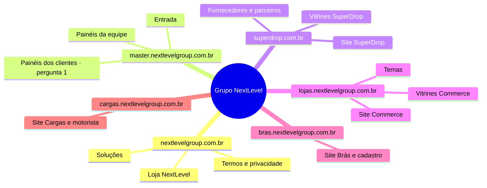

# Fase 2: proposta de reorganização das páginas (12/10/2026)

> Fase 2 do prompt `docs/prompts/mapa-paginas-dominios-painel.md`, sobre a avaliação `docs/mapa/AVALIACAO-LINKS-2026-10.md` e as suas decisões de 12/10 (D147).
> **Estado (12/10):** recomendações aceitas pelo dono e aplicadas em D149 (itens 1 a 7 e 9 da seção 4; 8 e 10 ficam como estão). As respostas da seção 5 estão marcadas abaixo.
> Toda mudança de endereço terá redirecionamento permanente, para nenhum link que cliente já usa quebrar, e um teste provando.

## 1. Já feito nesta rodada (aprovado em 12/10)

| Correção | Como ficou |
|---|---|
| Termos e privacidade do grupo | **Texto único do Grupo NextLevel** em `/termos` e `/privacidade`, em SuperDrop, Commerce, Cargas e no endereço do grupo. O rodapé de todas as marcas passa a ter os dois links; antes, SuperDrop e Commerce diziam "serão publicados aqui antes da abertura ao público". A Brás segue com o texto próprio (o aceite dela é versionado; ver a pergunta 4). Versão inicial, marcada "em revisão jurídica" |
| Menu da página de Soluções no Master | O endereço do grupo ganhou **menu próprio**: Soluções e as marcas (SuperDrop, Commerce, Brás, Cargas), cada uma pelo endereço dela, e o botão "Diagnóstico gratuito". Nenhum link leva mais à tela de login por engano |
| Categorias do fornecedor | Item **Categorias** no menu do fornecedor (Catálogo → Categorias) |

## 2. O racional (princípios)

1. **Cada endereço tem um papel:** site do grupo, site de cada marca, escritório (painéis), vitrines das lojas e links privados.
2. **Cada página pública tem uma marca dona.** O que é do grupo (NextLevel Soluções, Loja NextLevel, termos) mora no site do grupo.
3. **Nenhuma página órfã,** e todo link chega direto ao destino, sem corrente de redirecionamentos.
4. **Endereço novo nunca quebra o antigo:** redirecionamento permanente (308) e teste.
5. **Pronto para separar depois:** cada projeto poderá ter o próprio Master sem refazer os endereços (pergunta 1).

## 3. Árvore-alvo por endereço

```
nextlevelgroup.com.br  (site do grupo; até ligar o domínio na Fase 3, mora em master.nextlevelgroup.com.br)
├─ /solucoes  e  /solucoes/<produto>          NextLevel Soluções Digitais
├─ /loja-nextlevel  e  /loja-nextlevel/pedido/<código>   Loja NextLevel (agência)
└─ /termos  ·  /privacidade                    texto único do grupo

master.nextlevelgroup.com.br  (escritório)
├─ /login · /esqueci-senha · /redefinir-senha/<código>
└─ painéis: Master, Admin Commerce, Estúdio Brás (equipe NextLevel)  + clientes (ver pergunta 1)

superdrop.com.br
├─ / · /como-funciona · /planos · /faq · /cadastro · /quero-minha-loja · /ativar
├─ /seja-fornecedor · /parceiros (+ cadastro, entrar, termos) · /temas · /temas/<tema>
├─ /f/<fornecedor>  ·  /store/<loja SuperDrop>  ·  /loja/<loja>
├─ /r/<parceiro> · /c/<cupom>
└─ /termos · /privacidade

lojas.nextlevelgroup.com.br  (NextLevel Commerce)
├─ / · /planos · /temas · /temas/<tema> · /cadastro · /quero-minha-loja · /faq · /ativar
├─ /store/<loja Commerce>  ·  /loja/<loja>
└─ /termos · /privacidade

bras.nextlevelgroup.com.br   (sem mudança) / · /cadastro · /ativar · /quero-minha-loja · /d/<descoberta> · /balcao… · /termos · /privacidade (texto Brás)
cargas.nextlevelgroup.com.br (sem mudança) / · /ativar · /motorista/<código> · /termos · /privacidade
```



## 4. Endereço antigo → endereço novo (aplicar depois do sim)

| # | Hoje | Passa a | Por quê | Afeta cliente? |
|---|---|---|---|---|
| 1 | `superdrop.com.br/solucoes` e `lojas…/solucoes` (+ produtos) | 308 para o site do grupo (hoje `master…/solucoes`) | Soluções é da agência (D147) | Não: o link antigo continua funcionando |
| 2 | `superdrop.com.br/loja-nextlevel` e `lojas…/loja-nextlevel` | 308 para o site do grupo `/loja-nextlevel` | Loja NextLevel é da agência (D147) | Não; os links de pedido (`/loja-nextlevel/pedido/<código>`) também são redirecionados |
| 3 | `lojas…/f/<fornecedor>` (página de fornecedor SuperDrop) | 308 para `superdrop.com.br/f/<fornecedor>` | Fornecedor é do SuperDrop | Não |
| 4 | Loja de uma marca aberta no endereço da outra | 308 para o endereço da marca dona da loja | Cliente final vê a loja com a marca certa | Não; o carrinho é por loja |
| 5 | `/fornecedores` (link "Para quem fornece" da página inicial do SuperDrop) | Link direto para `/seja-fornecedor`; na Commerce, 308 para o SuperDrop | Acaba com a corrente de 2 saltos | Não |
| 6 | Atalho `/lojas` e `/lojas/sair` (deixa qualquer endereço com a cara da Commerce) | Só na demonstração | Era para apresentação; em produção confunde | Não |
| 7 | `/master/finance` (financeiro SuperDrop) × `/master/financeiro` (financeiro NextLevel) | Unir: o financeiro SuperDrop vira uma aba de `/master/financeiro` (já existe `/master/financeiro/superdrop`); `/master/finance` → 308 | Dois endereços quase iguais para coisas diferentes | Não (só a equipe) |
| 8 | `/master/bras`, `/master/commerce`, `/supplier/shipping` | Ficam como estão (já redirecionam) e documentados | Endereços antigos que alguém pode ter salvo | Não |
| 9 | Sem `sitemap.xml` e `robots.txt` por marca | Um de cada por marca, só com as páginas daquela marca | Buscadores encontram cada marca separada | Não |
| 10 | Nomes de painel em inglês (`/merchant`, `/supplier`, `/partner`) | **Ficam** (recomendação) | Trocar quebra favoritos e links de e-mail sem ganho para o cliente; o que a pessoa vê (menus e títulos) já é português | Não |

**Ordem sugerida (uma marca por vez, começando pelo que não afeta cliente):** 6 → 7 → 5 → 1 e 2 → 3 → 4 → 9. **Aplicada em D149.** Os redirecionamentos ficam temporários (307) até a Fase 3 fixar os domínios; depois viram permanentes (308).

## 5. Perguntas para você (com a minha recomendação)

1. **Painéis dos clientes no Master.**
   - **O problema:** hoje o lojista SuperDrop entra em superdrop.com.br/login e vê o painel com a cara do SuperDrop. Se todos os painéis forem para master.nextlevelgroup.com.br, ele passa a entrar num endereço "NextLevel" e todos precisam fazer login de novo.
   - **Recomendação:**
     - **agora**, só os painéis da **equipe NextLevel** (Master, Admin Commerce, Estúdio Brás) ficam exclusivos do Master, ligando a chave `MASTER_HOST_ONLY`, que já existe;
     - os **painéis dos clientes** continuam no endereço da marca deles, como "escritório da marca", e o painel que abrir no endereço de **outra** marca é redirecionado.
   - **Por que assim:** quando cada projeto ganhar o próprio Master, basta apontar o escritório de cada marca (a chave `BRAND_OFFICE_*` também já existe).
   - **Pergunta:** concorda?
2. **Site do grupo:** a página inicial de nextlevelgroup.com.br é a própria página de Soluções (recomendo, por ora) ou uma página nova de apresentação do grupo?
3. **Temas:** ficam no SuperDrop **e** na Commerce (os dois vendem temas aos lojistas), como hoje? Recomendo que sim.
4. **Brás:** unificar o texto legal da Brás com o do grupo agora (os membros terão de aceitar de novo, com o aviso que já existe no Meu Brás) ou depois? Recomendo depois da revisão jurídica do texto do grupo.
5. **Texto legal do grupo:** está publicado como "versão inicial, em revisão jurídica". Quer que um advogado revise antes de tirarmos esse aviso?

**Respostas do dono (12/10): aceitas as cinco recomendações** (1: só os painéis da equipe exclusivos do Master; 2: início do site do grupo = Soluções; 3: temas nos dois; 4: Brás depois; 5: revisão jurídica). Aplicado em D149.

Com as respostas, aplico os itens da seção 4 na ordem acima. O Mapa vivo passa a mostrar "fora do lugar" pela árvore-alvo completa, e a Fase 3 (domínios) começa por nextlevelgroup.com.br.
