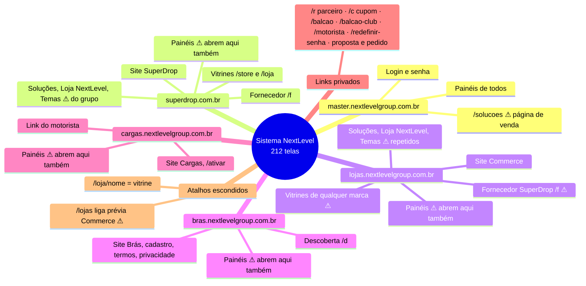

# Mapa do sistema, reorganização de páginas, domínios e painel "Mapa vivo" no Master: prompt engenheiro mestre

> **Pedido do dono (2026-10-12):** "o fato de https://master.nextlevelgroup.com.br/solucoes estar aqui demonstra que tem várias páginas em endereços inadequados; tem coisas que nem sei da existência. Precisamos de um novo racional e organização de páginas. Preciso de um mapa de todas as páginas públicas, um mapa de todo o sistema e de todos os painéis, tipo mapa mental ou árvore com todos os caminhos de navegação, e um painel dinâmico para eu ir abrindo cada hierarquia, testando e verificando o status de tudo. Primeiro uma avaliação de todo o sistema de links, depois uma sugestão de reorganização geral, depois configuração de domínios, depois a criação desse painel dentro do meu Master."
>
> **Como usar este arquivo**
> 1. Leia a **Parte 1** (o que já descobri, em linguagem simples) e dê uma olhada nos mapas da **Parte 3** (gerados do código e testados de verdade em 12/10).
> 2. Para executar, cole no Claude (ou no Codex) a **mensagem curta da Parte 2.0**. O agente segue as fases da Parte 2 e **para em cada fase para você aprovar**.
> 3. Nada muda de endereço sem a sua aprovação na Fase 2. A Fase 1 só levanta; a Fase 4 (o painel) pode começar em paralelo, porque não muda nenhum endereço.

---

## Parte 1. Avaliação inicial (o que o teste de 12/10 mostrou)

O sistema tem **212 telas** e **5 endereços no ar**:
- superdrop.com.br;
- lojas.nextlevelgroup.com.br (Commerce);
- master.nextlevelgroup.com.br;
- bras.nextlevelgroup.com.br;
- cargas.nextlevelgroup.com.br.

Cada endereço decide o que mostrar pelas regras de `src/lib/host-routing.ts` e `src/proxy.ts`. A Brás e a Cargas têm **lista fechada** de páginas, o Master só deveria ter painéis, e **SuperDrop e Commerce abrem quase tudo**.

**Problemas encontrados (cada um com a prova na Parte 3):**

1. **Página comercial no endereço do Master.** `master.nextlevelgroup.com.br/solucoes` (e cada `/solucoes/<produto>`) abre de propósito: a regra do Master libera `/solucoes` (decisão do financeiro D90). É uma página de venda num endereço de administração.
2. **SuperDrop e Commerce compartilham páginas que deveriam ser de uma só marca.** Abrem nos dois endereços:
   - `/solucoes`, `/loja-nextlevel` (cursos e assessorias), `/temas`, `/faq`, `/quero-minha-loja` e `/ativar`;
   - a página de fornecedor do SuperDrop (`/f/<fornecedor>`), que abre também na Commerce;
   - qualquer vitrine `/store/<loja>`, que abre nos dois endereços, inclusive loja SuperDrop no endereço da Commerce.
3. **Termos e privacidade só existem na Brás.** `/termos` e `/privacidade` dão **404** no SuperDrop e na Commerce: lacuna legal nas duas marcas que cobram de clientes.
4. **Corrente de redirecionamentos.** `/fornecedores` vai para `/seja-fornecedor`, que na Commerce volta para a página inicial: o link dá "volta" sem aviso.
5. **Painéis abrem em qualquer endereço.** O "endereço só dos painéis" (escritório) existe mas está desligado (D145). Por isso:
   - `/master`, `/meu-bras`, `/transportadora`, `/importadora`, `/bras` e os demais respondem nos 5 endereços (pedem login no endereço onde a pessoa está);
   - como a sessão é de cada endereço, a mesma pessoa pode entrar pelo endereço "errado" e não reconhecer a marca.
6. **Atalhos escondidos que o dono não conhece:**
   - **`/lojas`:** em qualquer endereço, liga uma prévia que faz o site parecer a Commerce, e `/lojas/sair` desliga;
   - **`/loja/<nome>`:** apelido da vitrine;
   - **`/r/<código>`:** link de parceiro;
   - **`/c/<código>`:** link de cupom;
   - **`/d/<id>`:** descoberta da Brás compartilhada;
   - **`/balcao/<código>`, `/balcao-club/<código>` e `/motorista/<código>`:** links privados;
   - **`/ativar`:** ativação de outra marca;
   - **`/demo/<chave>` e `/dev/design`:** só na demonstração;
   - **`/gravacao`:** só na demonstração;
   - **`/assets/<id>`:** imagens enviadas pelos lojistas;
   - **`/og/<arquivo>`:** prévias de link geradas.
7. **Sem mapa para buscadores.** Não há `sitemap.xml` nem `robots.txt` geral por marca, só por loja (`/store/<loja>/sitemap.xml`).
8. **Nomes técnicos em inglês nos endereços dos painéis** (`/merchant`, `/supplier`, `/partner`) convivem com nomes em português (`/meu-bras`, `/importadora`, `/transportadora`). Não é erro, mas não tem regra.
9. **A Central de qualidade (D142) já lista as 212 telas**, mas em lista plana e abrindo cada tela em **um** endereço só. Falta:
   - a árvore;
   - a visão "esta página × cada endereço";
   - a regra do que **deveria** abrir onde, para apontar o que está fora do lugar.

---

## Parte 2. O prompt (as quatro fases)

### 2.0 Mensagem curta para colar no agente

```
Leia por inteiro docs/prompts/mapa-paginas-dominios-painel.md e siga a Parte 2 como a sua tarefa, fase por fase.
Comece pela FASE 1 (só levantar, sem mudar nenhum endereço) e pare para eu aprovar. A FASE 4 (painel no Master)
pode ser feita em paralelo porque não muda endereço nenhum. Testes: durante o trabalho só tipos e estilo; a bateria
completa fica para a etapa final. Escreva em português simples e me mostre capturas de tela antes de publicar.
```

### 2.1 Papel, regras e fontes

```
PAPEL
Você é arquiteto de informação e engenheiro sênior do Grupo NextLevel. Um único sistema (Next.js 16, TypeScript estrito, Drizzle) atende várias marcas por
endereço: NextLevel/Master (master.nextlevelgroup.com.br), SuperDrop (superdrop.com.br), NextLevel Commerce (lojas.nextlevelgroup.com.br; nextlevelcommerce.com.br
a registrar), Brás Digital (bras.nextlevelgroup.com.br), NextLevel Cargas (cargas.nextlevelgroup.com.br); Hub Creators e China Hub "em breve", sem domínio.

REGRAS (obrigatórias)
- Leia antes: AGENTS.md, CLAUDE.md, docs/constituicao/00-CONSTITUICAO-ECOMMERCE.md, docs/design/DECISIONS.md (D42, D79, D90, D92, D108, D138, D142, D145),
  src/lib/brand.ts, src/lib/host-routing.ts, src/proxy.ts, src/lib/nav.ts, src/lib/qualidade/rotas.ts e este arquivo inteiro (inclusive a Parte 3).
- SuperDrop está em produção com clientes: nenhum endereço que cliente já usa (vitrine, login, links de parceiro /r, cupom /c, página de fornecedor /f,
  links privados) pode quebrar. Mudou de lugar → redirecionamento permanente (301/308) e teste provando.
- Um tenant nunca vê dados de outro; permissões no servidor; a marca vem do endereço (getBrand()). Nada de "se marca X" em componente.
- Regras de negócio e textos comerciais não mudam neste projeto; o assunto é ONDE cada página mora e COMO se chega a ela.
- Toda decisão nova em docs/design/DECISIONS.md. Testes: durante o trabalho só npx tsc --noEmit e npx eslint src e2e tests (e o teste do arquivo mexido);
  bateria completa (npx vitest run) e npm run build só na etapa final de cada fase que for publicar.
- Domínio, DNS e variáveis do Render só mudam com aprovação explícita do dono, uma de cada vez, com o passo a passo para ele.
```

### 2.2 FASE 1: avaliação de todo o sistema de links (só levantar)

```
Entregue docs/mapa/AVALIACAO-LINKS-2026-10.md e a planilha docs/mapa/rotas.csv com:
A. Inventário completo e automático (script em scripts/mapa-rotas.ts, reaproveitando listAppRoutes() e describeRoutes() da Central de qualidade):
   - todas as telas (page.tsx), rotas de arquivo (route.ts: /r, /c, /og, /assets, csv, modelos), redirecionamentos (next.config, proxy, host-routing),
     apelidos (/loja/<nome>, subdomínio de loja), atalhos (/lojas, /lojas/sair) e páginas só de demonstração;
   - para cada uma: área, público (visitante, cliente, lojista, fornecedor, expedição, parceiro, membro Brás, importadora, transportadora, equipe Master, dono),
     de onde se chega (menu, link em outra página, e-mail, link privado, nenhum = órfã) e o que ela faz.
B. Matriz página × endereço testada de verdade (servidor local com BRAND_DOMAINS_* apontando 5 endereços, como na Parte 3 deste arquivo; e na produção
   só com GET em páginas públicas): status (abre, 404, redireciona e para onde, corrente de redirecionamentos).
C. Links quebrados e cadeias: varra os href de todas as páginas públicas e dos menus (nav.ts) e siga cada um; liste 404, corrente com mais de 1 salto,
   link que leva a outra marca sem aviso, link em inglês × português.
D. Páginas órfãs (sem nenhum link que leve a elas), páginas duplicadas (mesmo papel em dois endereços) e páginas "de uma marca" abrindo em outra.
E. Diagnóstico em português simples, em ordem de gravidade (cliente afetado > venda afetada > organização), confirmando ou corrigindo a Parte 1.
Pare e peça aprovação.
```

### 2.3 FASE 2: proposta de reorganização geral (proposta; aplicar só depois de aprovada)

```
Proponha o NOVO RACIONAL, com uma árvore-alvo por endereço e a tabela "de → para" de cada página que muda:
1. Princípios: (a) cada endereço tem um papel (site da marca, escritório dos painéis, vitrines das lojas, links privados); (b) cada página pública pertence
   a UMA marca, e o que é do grupo (Soluções, Loja NextLevel, termos do grupo) tem casa própria; (c) painéis no escritório; (d) nada de página órfã;
   (e) nomes de endereço em português claro para o público, sem quebrar os de hoje (redirecionamento permanente).
2. Onde fica "NextLevel Soluções" (/solucoes) e a "Loja NextLevel" (/loja-nextlevel): proposta recomendada com alternativa (ex.: site do grupo em
   nextlevelgroup.com.br/solucoes; Master só com painéis).
3. Termos e privacidade por marca (SuperDrop e Commerce hoje sem), FAQ por marca, temas só onde se vendem, página do fornecedor e vitrines só no
   endereço da marca dona da loja (loja SuperDrop no endereço da Commerce passa a redirecionar).
4. Painéis: endereço de escritório por marca (office.superdrop.com.br, painel.nextlevelcommerce.com.br…) ou tudo no Master com seletor de marca:
   compare as duas, recomende uma.
5. Atalhos e links privados: o que fica, o que vira documentado, o que sai (ex.: /lojas).
6. Mapa mental final (Mermaid "mindmap" + árvore em texto) do sistema reorganizado e a lista de redirecionamentos.
Aplicar (depois do sim do dono): mudanças pequenas, uma marca por vez, começando pelo que não afeta cliente; teste de redirecionamento para cada "de → para";
sitemap.xml e robots.txt por marca com só as páginas daquela marca.
```

### 2.4 FASE 3: configuração de domínios (passo a passo para o dono)

```
Entregue docs/mapa/DOMINIOS.md com:
1. Tabela final: domínio → marca → papel (site, escritório, vitrines, links) → onde está registrado (Hostinger, Registro.br) → DNS (CNAME/A para o Render)
   → variável no Render (BRAND_DOMAINS_*, BRAND_URL_*, BRAND_OFFICE_*, MASTER_HOST_ONLY, SUPERDROP_ROOT_DOMAIN) → situação de hoje (/api/health).
2. Ordem segura para ligar (um domínio por vez): registrar → apontar DNS → adicionar no Render → esperar o certificado → conferir /api/health →
   só então ligar a variável. Inclua o que fazer se der errado (como voltar).
3. nextlevelcommerce.com.br (a registrar), nextlevelgroup.com.br (site do grupo?), escritórios, subdomínio das lojas (slug.superdrop.com.br) e e-mail
   (SPF/DKIM do Resend por domínio).
4. A aba "Domínios" da Central de qualidade já confere /api/health; acrescente nela a coluna "o que deveria estar ligado" × "o que está".
Nada é ligado por você: entregue o passo a passo e, a cada passo que o dono fizer, confira e registre.
```

### 2.5 FASE 4: painel "Mapa vivo" dentro do Master (pode começar em paralelo)

```
Construa no Master, ESTENDENDO a Central de qualidade (/master/qualidade, D142, D145; regra anti-duplicação: nada de painel novo separado), uma aba
"Mapa vivo" com:
1. Árvore navegável por hierarquia: Endereço (marca) → Área (site, escritório, vitrines, links privados, demonstração) → Seção (menu do painel ou grupo
   de páginas) → Página → Variações (exemplo de loja, de produto, de link). Abrir e fechar cada nível; contadores em cada galho (total, testadas,
   aprovadas, com problema, falhou na checagem). Busca e filtros (marca, público, status).
2. Duas visões da mesma árvore: "Como está hoje" (o que o teste viu) e "Como deve ficar" (a árvore-alvo aprovada na Fase 2), com destaque em cada página
   fora do lugar (abre onde não deveria, 404 onde deveria abrir, corrente de redirecionamentos, órfã).
3. Em cada página: abrir no endereço certo (nova aba), status de cada endereço (matriz da Fase 1, guardada), marcar testada/aprovada/problema
   (reaproveita qa_screens), anotação, o que falta (D143) e "entrar como" (modo suporte) para painéis.
4. Checagem por galho: botão "checar este galho" que testa só aquele pedaço (todas as páginas × endereços daquele galho) e salva em qa_runs; histórico.
5. Mapa mental: visão em diagrama do galho aberto (pode ser SVG gerado no servidor ou lista recolhível; nada de biblioteca pesada sem justificar).
6. Fonte única: a árvore sai dos arquivos do sistema + nav.ts + regras de endereço (página nova aparece sozinha) e da árvore-alvo aprovada (arquivo
   src/lib/qualidade/mapa-alvo.ts). Só o dono vê (como a Central).
7. Acessibilidade AA, teclado (setas abrem/fecham galhos), 360 px sem rolagem lateral; capturas em 360 e 1440 px para o dono aprovar.
Testes do domínio (árvore, contadores, "fora do lugar", checagem por galho) e e2e da aba; bateria completa só no fim.
```

### 2.6 Entrega de cada fase

```
- Caminho dos arquivos, mapas (texto e Mermaid) e capturas; resumo de 10 linhas em português para o dono.
- O que foi medido e o que NÃO foi medido.
- Uma pergunta de aprovação no final.
```

### 2.7 Perguntas para o dono (o agente traz a recomendação de cada uma)

1. Onde mora o site do grupo e a "NextLevel Soluções": `nextlevelgroup.com.br`, dentro do SuperDrop, ou na Commerce?
2. Painéis: um escritório por marca (`office.superdrop.com.br`, …) ou todos no Master com seletor de marca?
3. A "Loja NextLevel" (cursos e assessorias) é do grupo ou de uma marca?
4. Termos e privacidade: um texto do grupo com uma página por marca, ou textos próprios por marca?
5. Registrar agora `nextlevelcommerce.com.br` e `nextlevelgroup.com.br` (site)?

---

## Parte 3. Mapas atuais (gerados do código e testados em 12/10/2026)

> Base para a Fase 1 (o agente deve regenerar e ampliar). As páginas `/dev/design` e `/gravacao` aparecem como "abre" porque o teste rodou no modo
> demonstração; **na produção dão 404** (conferido em superdrop.com.br e lojas.nextlevelgroup.com.br).

### Mapa mental resumido (como está hoje)



## A. Mapa das páginas públicas × endereço (teste real, 2026-10-12)

Cada linha é uma página; cada coluna, um endereço. "abre" = a página aparece ali; "vai p/" = o sistema redireciona. Teste feito no servidor local com as mesmas regras de endereço da produção (SD = superdrop.com.br, CM = lojas.nextlevelgroup.com.br, NL = master.nextlevelgroup.com.br, BD = bras.nextlevelgroup.com.br, CG = cargas.nextlevelgroup.com.br). Páginas com código no endereço (links privados) aparecem como "precisa de exemplo".

| Página | Nome | SD | CM | NL | BD | CG |
|---|---|---|---|---|---|---|
| `/f/[slug]` | Página do fornecedor | abre | abre | vai p/ /login | vai p/ / | vai p/ / |
| `/store/[slug]` | Vitrine da loja | abre | abre | vai p/ /login | vai p/ / | vai p/ / |
| `/store/[slug]/acompanhar` | Acompanhar | precisa de exemplo | | | | |
| `/store/[slug]/cart` | Cart | abre | abre | vai p/ /login | vai p/ / | vai p/ / |
| `/store/[slug]/catalog` | Catalog | abre | abre | vai p/ /login | vai p/ / | vai p/ / |
| `/store/[slug]/checkout` | Checkout | precisa de exemplo | | | | |
| `/store/[slug]/product/[productSlug]` | Product (productSlug) | precisa de exemplo | | | | |
| `/` | Página inicial | abre | abre | vai p/ /login | abre | abre |
| `/ativar` | Ativação de outra marca | abre | abre | vai p/ /login | abre | abre |
| `/cadastro` | Criar conta | abre | abre | vai p/ /login | abre | vai p/ / |
| `/como-funciona` | Como funciona | abre | vai p/ / | vai p/ /login | vai p/ / | vai p/ / |
| `/esqueci-senha` | Esqueci senha | abre | abre | abre | abre | abre |
| `/faq` | Faq | abre | abre | vai p/ /login | vai p/ / | vai p/ / |
| `/fornecedores` | Fornecedores | vai p/ /seja-fornecedor | vai p/ /seja-fornecedor | vai p/ /login | vai p/ / | vai p/ / |
| `/login` | Entrada (login) | abre | abre | abre | abre | abre |
| `/loja-nextlevel` | Loja nextlevel | abre | abre | vai p/ /login | vai p/ / | vai p/ / |
| `/parceiros` | Parceiros | abre | vai p/ / | vai p/ /login | vai p/ / | vai p/ / |
| `/parceiros/cadastro` | Cadastro | abre | vai p/ / | vai p/ /login | vai p/ / | vai p/ / |
| `/parceiros/entrar` | Entrar | abre | vai p/ / | vai p/ /login | vai p/ / | vai p/ / |
| `/parceiros/termos` | Termos | abre | vai p/ / | vai p/ /login | vai p/ / | vai p/ / |
| `/planos` | Planos | abre | abre | vai p/ /login | vai p/ / | vai p/ / |
| `/privacidade` | Privacidade | **404** | **404** | vai p/ /login | abre | vai p/ / |
| `/quero-minha-loja` | Quero minha loja | abre | abre | vai p/ /login | abre | vai p/ / |
| `/seja-fornecedor` | Seja fornecedor | abre | vai p/ / | vai p/ /login | vai p/ / | vai p/ / |
| `/solucoes` | Solucoes | abre | abre | abre | vai p/ / | vai p/ / |
| `/solucoes/[slug]` | Solucoes (slug) | abre | abre | abre | vai p/ / | vai p/ / |
| `/temas` | Temas | abre | abre | vai p/ /login | vai p/ / | vai p/ / |
| `/temas/[key]` | Temas (key) | precisa de exemplo | | | | |
| `/termos` | Termos | **404** | **404** | vai p/ /login | abre | vai p/ / |
| `/balcao-club/[token]` | Balcao club (token) | precisa de exemplo | | | | |
| `/balcao/[token]` | Balcao (token) | precisa de exemplo | | | | |
| `/d/[id]` | D (id) | precisa de exemplo | | | | |
| `/loja-nextlevel/pedido/[token]` | Pedido (token) | precisa de exemplo | | | | |
| `/motorista/[token]` | Motorista (token) | precisa de exemplo | | | | |
| `/redefinir-senha/[token]` | Redefinir senha (token) | precisa de exemplo | | | | |
| `/store/[slug]/order/[id]` | Order (id) | precisa de exemplo | | | | |
| `/store/[slug]/proposta/[token]` | Proposta (token) | precisa de exemplo | | | | |
| `/demo/[key]` | Demo (key) | precisa de exemplo | | | | |
| `/dev/design` | Design | abre | abre | vai p/ /login | vai p/ / | vai p/ / |
| `/dev/design/amostra` | Amostra | abre | abre | vai p/ /login | vai p/ / | vai p/ / |
| `/gravacao` | Gravacao | abre | abre | vai p/ /login | vai p/ / | vai p/ / |

Painéis (todas as rotas abaixo de /master, /merchant, /supplier, /partner, /meu-bras, /importadora, /transportadora, /bras, /commerce, /account, /theme-editor): hoje **abrem em qualquer um dos 5 endereços** (sem login, levam à entrada daquele endereço).

## B. Árvore de todo o sistema (todas as telas, por área)

Total: 212 telas, lidas dos próprios arquivos do sistema (`src/app/**/page.tsx`).

### Master (46) · painel

Como entrar: Direto, com o seu login de dono.

```
└─ master  · Dashboard
   ├─ bras  · Bras
   ├─ catalog  · Catálogo
   ├─ clientes  · Clientes e suporte
   ├─ commerce  · Commerce
   ├─ crm  · CRM Loja NextLevel
   │  └─ [id]  · Crm (id)
   ├─ ecossistema  · Torre do Ecossistema
   ├─ equipe  · Equipe do Master
   ├─ errors  · Erros do sistema
   ├─ finance  · Financeiro SuperDrop
   ├─ financeiro  · Financeiro NextLevel
   │  ├─ assinaturas  · Assinaturas
   │  ├─ auditoria  · Auditoria
   │  ├─ catalogo  · Catalogo
   │  │  └─ [key]  · Catalogo (key)
   │  ├─ descoberta  · Descoberta
   │  ├─ experimentos  · Experimentos
   │  ├─ gateways  · Gateways
   │  ├─ jornada  · Jornada
   │  ├─ ofertas  · Ofertas e comissões
   │  ├─ pagamentos  · Pagamentos
   │  ├─ parceiros  · Parceiros
   │  ├─ precos  · Preços do grupo
   │  ├─ proposta  · Proposta de preço
   │  ├─ propostas  · Propostas
   │  └─ superdrop  · Superdrop
   ├─ integridade  · Integridade dos dados
   ├─ marcas
   │  └─ [marca]  · Marcas (marca)
   ├─ networks  · Redes
   ├─ office  · Escritório virtual
   ├─ orders  · Pedidos
   │  └─ [id]  · Orders (id)
   ├─ partners  · Parceiros
   │  └─ [id]  · Partners (id)
   ├─ plans  · Planos
   ├─ qualidade  · Central de qualidade
   ├─ services  · Loja NextLevel
   │  └─ [id]  · Services (id)
   ├─ settings  · Configurações
   ├─ stores  · Lojas
   │  └─ [slug]  · Stores (slug)
   ├─ summary  · Resumo do dia
   ├─ suppliers  · Fornecedores
   │  └─ new  · Novo fornecedor
   └─ templates  · Templates
```

### Admin Commerce (7) · painel

Como entrar: Direto, com o seu login de dono.

```
└─ commerce  · NextLevel Commerce
   ├─ catalog  · Catálogo das lojas
   ├─ leads  · Interessados
   ├─ orders  · Vendas
   ├─ plans  · Assinaturas
   ├─ settings  · Plataforma
   └─ stores  · Lojas
```

### Estúdio Brás (18) · painel

Como entrar: Direto, com o seu login de dono.

```
└─ bras  · Brás Digital
   ├─ acesso  · Acesso e planos
   ├─ atendimento  · Atendimento
   ├─ balcao  · Balcao
   ├─ club  · Brás Digital Club
   ├─ comissoes  · Comissões
   ├─ descobertas  · Descobertas
   ├─ excursao  · Ônibus de excursão
   ├─ grupo  · Empresas do grupo
   ├─ importadoras  · Importadoras
   │  └─ [id]  · Importadoras (id)
   ├─ membros  · Membros
   ├─ meu-contador  · Meu Contador
   ├─ pauta  · Pauta de conteúdo
   ├─ regras  · Planos e regras
   ├─ romaneio
   │  └─ [id]  · Romaneio (id)
   ├─ transportadoras  · Transportadoras (Cargas)
   └─ visao  · Visão geral
```

### Fornecedor (24) · painel

Como entrar: Modo suporte: em Clientes e suporte, entre como um fornecedor.

```
└─ supplier  · Esteira
   ├─ content  · Conteúdo
   ├─ finance  · Financeiro
   ├─ inventory  · Estoque
   ├─ invoices  · Faturas
   ├─ operations  · Corte e operação
   ├─ orders  · Pedidos
   │  └─ [id]  · Orders (id)
   │     └─ print  · Print
   ├─ products  · Produtos
   │  ├─ [id]  · Products (id)
   │  ├─ categorias  · Categorias
   │  ├─ import  · Importar produtos por CSV
   │  └─ new  · Novo produto
   ├─ services  · Loja NextLevel
   │  ├─ [id]  · Services (id)
   │  └─ solucao
   │     └─ [slug]  · Solucao (slug)
   ├─ settings  · Configurações
   ├─ shipping  · Shipping
   ├─ store  · Minha loja
   ├─ stores  · Lojistas
   │  └─ new  · Nova loja
   ├─ team  · Equipe
   └─ wallets  · Recargas
```

### Expedição (4) · painel

Como entrar: Modo suporte: entre como alguém da expedição.

```
└─ supplier
   └─ dispatch  · Abrir tela da expedição
      ├─ print  · Imprimir etiquetas
      ├─ shipped  · Enviados
      └─ wave
         └─ [id]  · Wave (id)
```

### Lojista (35) · painel

Como entrar: Modo suporte: entre como um lojista (SuperDrop ou Commerce; o painel muda conforme a loja).

```
├─ merchant  · Início
│  ├─ after-sales  · Pós-venda
│  ├─ analytics  · Análise
│  ├─ appearance  · Appearance
│  ├─ atacado  · Atacado
│  ├─ auditoria  · Histórico
│  ├─ avaliacoes  · Avaliações
│  ├─ avise-me  · Avise-me
│  ├─ campanhas  · Campanhas
│  ├─ catalogo  · Produtos
│  │  ├─ [id]  · Catalogo (id)
│  │  ├─ categorias  · Categorias
│  │  ├─ import  · Import
│  │  └─ new  · New
│  ├─ content  · Conteúdo
│  ├─ customers  · Clientes
│  │  └─ [id]  · Customers (id)
│  ├─ descontos  · Cupons
│  ├─ finance  · Financeiro
│  ├─ labels  · Etiquetas
│  ├─ orders  · Pedidos
│  │  ├─ [id]  · Orders (id)
│  │  │  └─ print  · Print
│  │  ├─ new  · Novo pedido
│  │  └─ propostas  · Propostas
│  ├─ products  · Catálogo
│  ├─ services  · Loja NextLevel
│  │  ├─ [id]  · Services (id)
│  │  └─ solucao
│  │     └─ [slug]  · Solucao (slug)
│  ├─ settings  · Configurações
│  ├─ storefront  · Loja Virtual
│  ├─ team  · Equipe
│  ├─ templates  · Templates
│  └─ wallet  · Saldo e recargas
└─ theme-editor  · Editor do tema
```

### Parceiro (8) · painel

Como entrar: Modo suporte: entre como um parceiro.

```
└─ partner  · Início
   ├─ catalogo  · Catálogo comercial
   ├─ coupons  · Cupons de 7 dias
   ├─ crm  · CRM de clientes
   ├─ finance  · Financeiro
   ├─ links  · Links
   ├─ profile  · Meu perfil
   └─ referrals  · Indicados
```

### Membro Brás (13) · painel

Como entrar: Modo suporte: entre como um membro da Brás.

```
└─ meu-bras  · Início
   ├─ club  · Indique e ganhe
   ├─ descoberta
   │  └─ [id]  · Descoberta (id)
   ├─ empresa  · Minha empresa
   ├─ fretes  · Fretes
   │  └─ etiquetas  · Etiquetas
   ├─ meu-contador  · Meu Contador
   ├─ pedidos  · Meus pedidos
   │  └─ [id]
   │     └─ retirada  · Retirada
   ├─ pedir
   │  └─ [id]  · Pedir (id)
   ├─ perfil  · Meu perfil
   ├─ suporte  · Suporte
   └─ videos  · Descobertas
```

### Importadora (7) · painel

Como entrar: Modo suporte: entre como alguém de uma importadora.

```
└─ importadora  · Hoje
   ├─ estoque  · Estoque
   ├─ galpoes  · Galpões, equipe e ficha
   ├─ indicacoes  · Indique e ganhe
   ├─ pedidos  · Pedidos
   ├─ produtos  · Produtos e caixas
   └─ transportadoras  · Transportadoras
```

### Transportadora (7) · painel

Como entrar: Modo suporte: entre como uma transportadora ou ônibus.

```
└─ transportadora  · Hoje
   ├─ cargas  · Cargas
   ├─ extrato  · Extrato
   ├─ importadoras  · Importadoras na rede
   ├─ indicacoes  · Indique e ganhe
   ├─ perfil  · Perfil e motorista
   └─ rotas  · Rotas e viagens
```

### Conta (2) · painel

Como entrar: Qualquer pessoa logada.

```
└─ account
   ├─ marcas  · Suas marcas
   └─ password  · Trocar a senha
```

### Vitrines das lojas (7) · pública

Como entrar: Sem login. Informe o endereço de uma loja no exemplo.

```
├─ f
│  └─ [slug]  · Página do fornecedor
└─ store
   └─ [slug]  · Vitrine da loja
      ├─ acompanhar  · Acompanhar
      ├─ cart  · Cart
      ├─ catalog  · Catalog
      ├─ checkout  · Checkout
      └─ product
         └─ [productSlug]  · Product (productSlug)
```

### Páginas públicas (22) · pública

Como entrar: Sem login. Abra em cada marca pelo seletor de domínio.

```
/  · Página inicial
├─ ativar  · Ativação de outra marca
├─ cadastro  · Criar conta
├─ como-funciona  · Como funciona
├─ esqueci-senha  · Esqueci senha
├─ faq  · Faq
├─ fornecedores  · Fornecedores
├─ login  · Entrada (login)
├─ loja-nextlevel  · Loja nextlevel
├─ parceiros  · Parceiros
│  ├─ cadastro  · Cadastro
│  ├─ entrar  · Entrar
│  └─ termos  · Termos
├─ planos  · Planos
├─ privacidade  · Privacidade
├─ quero-minha-loja  · Quero minha loja
├─ seja-fornecedor  · Seja fornecedor
├─ solucoes  · Solucoes
│  └─ [slug]  · Solucoes (slug)
├─ temas  · Temas
│  └─ [key]  · Temas (key)
└─ termos  · Termos
```

### Links privados (8) · link privado

Como entrar: Só com o link enviado (código no endereço): cole um link real no exemplo.

```
├─ balcao-club
│  └─ [token]  · Balcao club (token)
├─ balcao
│  └─ [token]  · Balcao (token)
├─ d
│  └─ [id]  · D (id)
├─ loja-nextlevel
│  └─ pedido
│     └─ [token]  · Pedido (token)
├─ motorista
│  └─ [token]  · Motorista (token)
├─ redefinir-senha
│  └─ [token]  · Redefinir senha (token)
└─ store
   └─ [slug]
      ├─ order
      │  └─ [id]  · Order (id)
      └─ proposta
         └─ [token]  · Proposta (token)
```

### Só na demonstração (4) · só demonstração

Como entrar: Existe só no ambiente de demonstração.

```
├─ demo
│  └─ [key]  · Demo (key)
├─ dev
│  └─ design  · Design
│     └─ amostra  · Amostra
└─ gravacao  · Gravacao
```

## C. Menus de cada painel (o que cada pessoa vê na barra lateral)

### NextLevel Master (NEXTLEVEL_MASTER)

- **Principal:** Loja NextLevel (`/master/services`)
- **Plataformas:** NextLevel Commerce (`/commerce`) · Brás Digital (`/bras`)
- **Operação:** Dashboard (`/master`) · Clientes e suporte (`/master/clientes`) · Pedidos (`/master/orders`) · Resumo do dia (`/master/summary`) · Erros do sistema (`/master/errors`) · Integridade dos dados (`/master/integridade`) · Central de qualidade (`/master/qualidade`) · CRM Loja NextLevel (`/master/crm`)
- **Rede:** Fornecedores (`/master/suppliers`) · Redes (`/master/networks`) · Lojas (`/master/stores`) · Catálogo (`/master/catalog`)
- **Negócio:** Parceiros (`/master/partners`) · Escritório virtual (`/master/office`) · Torre do Ecossistema (`/master/ecossistema`) · Equipe do Master (`/master/equipe`) · Financeiro NextLevel (`/master/financeiro`) · Financeiro SuperDrop (`/master/finance`) · Templates (`/master/templates`) · Planos (`/master/plans`) · Configurações (`/master/settings`)

### Fornecedor (SUPPLIER_ADMIN)

- **Principal:** Loja NextLevel (`/supplier/services`)
- **Operação:** Esteira (`/supplier`) · Pedidos (`/supplier/orders`) · Corte e operação (`/supplier/operations`)
- **Financeiro:** Recargas (`/supplier/wallets`) · Faturas (`/supplier/invoices`) · Financeiro (`/supplier/finance`)
- **Rede:** Lojistas (`/supplier/stores`) · Minha loja (`/supplier/store`) · Equipe (`/supplier/team`)
- **Catálogo:** Produtos (`/supplier/products`) · Estoque (`/supplier/inventory`) · Conteúdo (`/supplier/content`)
- **Conta:** Configurações (`/supplier/settings`)

### Expedição (SUPPLIER_DISPATCH)

- **Principal:** Fila de expedição (`/supplier/dispatch`) · Imprimir etiquetas (`/supplier/dispatch/print`) · Enviados (`/supplier/dispatch/shipped`)

### Lojista (STORE_OWNER)

- **Principal:** Loja NextLevel (`/merchant/services`)
- **Vendas:** Início (`/merchant`) · Pedidos (`/merchant/orders`) · Análise (`/merchant/analytics`) · Pós-venda (`/merchant/after-sales`) · Etiquetas (`/merchant/labels`) · Clientes (`/merchant/customers`)
- **Catálogo:** Catálogo (`/merchant/products`) · Conteúdo (`/merchant/content`)
- **Loja virtual:** Loja Virtual (`/merchant/storefront`) · Editor do tema (`/theme-editor`) · Templates (`/merchant/templates`) · Campanhas (`/merchant/campanhas`) · Cupons (`/merchant/descontos`) · Avaliações (`/merchant/avaliacoes`) · Avise-me (`/merchant/avise-me`) · Atacado (`/merchant/atacado`)
- **Financeiro:** Saldo e recargas (`/merchant/wallet`) · Financeiro (`/merchant/finance`)
- **Conta:** Equipe (`/merchant/team`) · Histórico (`/merchant/auditoria`) · Configurações (`/merchant/settings`)

### Membro Brás Digital (BRAS_MEMBER)

- **Meu Brás:** Início (`/meu-bras`) · Descobertas (`/meu-bras/videos`) · Meus pedidos (`/meu-bras/pedidos`) · Fretes (`/meu-bras/fretes`) · Indique e ganhe (`/meu-bras/club`) · Meu Contador (`/meu-bras/meu-contador`) · Suporte (`/meu-bras/suporte`)
- **Conta:** Meu perfil (`/meu-bras/perfil`) · Minha empresa (`/meu-bras/empresa`)

### Importadora Brás Digital (BRAS_IMPORTER)

- **Operação:** Hoje (`/importadora`) · Pedidos (`/importadora/pedidos`) · Transportadoras (`/importadora/transportadoras`)
- **Conta:** Indique e ganhe (`/importadora/indicacoes`) · Galpões, equipe e ficha (`/importadora/galpoes`)
- **Catálogo:** Produtos e caixas (`/importadora/produtos`) · Estoque (`/importadora/estoque`)

### Transportadora NextLevel Cargas (CARRIER)

- **Cargas:** Hoje (`/transportadora`) · Cargas (`/transportadora/cargas`) · Rotas e viagens (`/transportadora/rotas`) · Importadoras na rede (`/transportadora/importadoras`)
- **Conta:** Indique e ganhe (`/transportadora/indicacoes`) · Perfil e motorista (`/transportadora/perfil`)
- **Financeiro:** Extrato (`/transportadora/extrato`)

### Parceiro (AFFILIATE)

- **Escritório:** Início (`/partner`)
- **Divulgação:** Links (`/partner/links`) · Cupons de 7 dias (`/partner/coupons`)
- **Vendas:** CRM de clientes (`/partner/crm`) · Catálogo comercial (`/partner/catalogo`)
- **Resultados:** Indicados (`/partner/referrals`) · Financeiro (`/partner/finance`)
- **Conta:** Meu perfil (`/partner/profile`)

### Loja Commerce (lojista)

- **Principal:** Início (`/merchant`)
- **Vendas:** Pedidos (`/merchant/orders`) · Clientes (`/merchant/customers`) · Pós-venda (`/merchant/after-sales`)
- **Catálogo:** Produtos (`/merchant/catalogo`) · Categorias (`/merchant/catalogo/categorias`)
- **Marketing:** Campanhas (`/merchant/campanhas`) · Cupons (`/merchant/descontos`) · Avaliações (`/merchant/avaliacoes`)
- **Loja virtual:** Visão da loja (`/merchant/storefront`) · Aparência (`/theme-editor`) · Temas (`/merchant/templates`)
- **Gestão:** Análise (`/merchant/analytics`) · Financeiro (`/merchant/finance`)
- **Configurações:** Empresa e loja (`/merchant/settings`) · Equipe (`/merchant/team`) · Minha assinatura (`/merchant/finance#assinatura`) · Registro de ações (`/merchant/auditoria`)

### Admin Commerce (equipe NextLevel)

- **Plataforma:** Visão geral (`/commerce`)
- **Operação:** Lojas (`/commerce/stores`) · Vendas (`/commerce/orders`) · Catálogo das lojas (`/commerce/catalog`)
- **Crescimento:** Interessados (`/commerce/leads`)
- **Negócio:** Assinaturas (`/commerce/plans`)
- **Sistema:** Plataforma (`/commerce/settings`)

### Estúdio Brás (equipe NextLevel)

- **Operação:** Visão geral (`/bras/visao`) · Pedidos (`/bras`) · Comissões (`/bras/comissoes`) · Atendimento (`/bras/atendimento`) · Meu Contador (`/bras/meu-contador`)
- **Catálogo:** Descobertas (`/bras/descobertas`) · Importadoras (`/bras/importadoras`) · Pauta de conteúdo (`/bras/pauta`) · Transportadoras (Cargas) (`/bras/transportadoras`) · Ônibus de excursão (`/bras/excursao`)
- **Configuração:** Empresas do grupo (`/bras/grupo`) · Planos e regras (`/bras/regras`)
- **Pessoas:** Brás Digital Club (`/bras/club`) · Membros (`/bras/membros`) · Acesso e planos (`/bras/acesso`)
